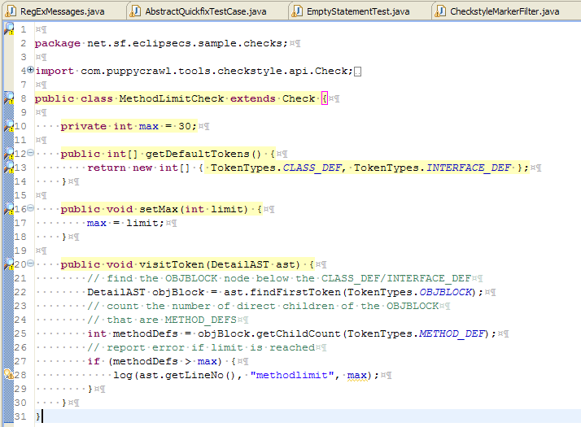
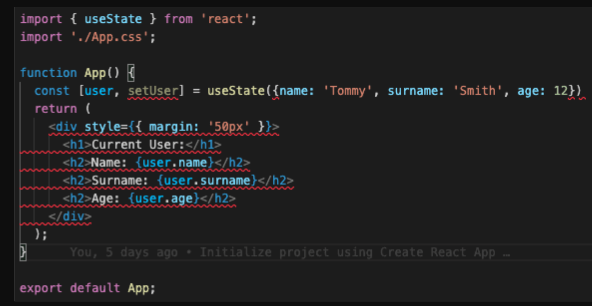

## Coding Standards: How Important Are They?


Coding standards are rules/guidelines on how code is written and structed. The purpose of coding standards is that it helps with consistensity, maintainability, and readability, making it easier for others to understand the code you write. Using tools, it can also helps detect errors before compiling, which is useful for saving time. These factors will help with efficient software development. 

An example of a common coding practice is naming variables and functions clearly.

Here's an example of a function with an unclear name:
```
function foo(a) {
    return a + 2;
}
```

Even if the name is unclear, it's easy to see what the function does. However, if the function was more complex, it'll be a bit harder to see what it does. 

Here's the same function with a more specific name:
```
function addTwo(value) {
    return value + 2;
}
```

The name of the function helps explain what it does. Properly naming variables can also help keep track on what it is. 

## My Experience with ESLint

ESLint is a tool that helps with finding errors in your JavasScript code before running it. One of the rules I understood was proper indentation, where it makes code more neat and readable. ESLint also informs you on whether a variable or function is used or not. I didn’t understand the purpose of the newline at the end of the file and using single quotes. 

ESLint feels similar to the Checkstyle plugin in Eclipse IDE. I remember that I mostly fixed indentation and had to add Javadoc comments. Both of these tools check for errors and if the code follows guidelines. 

What Checkstyle looks like:



What ESLint looks like:



I did some research on why the rules I was confused about exist. I read on the [official website]([https://www.example.com](https://archive.eslint.org/docs/2.0.0/rules/quotes) that it’s useful for string style consistency and the rule can be disabled. The rule can also be changed to use double and backtick quotes instead. 

About the newline at the end of the file, it's used because it's a common UNIX idiom. The website states that the benefits of it is that "newlines include the ability to concatenate or append to files as well as output files to the terminal without interfering with shell prompts."

In conclusion, coding standards make working with code more effiecient, with the help of tools such as ESLint and Checkstyle. 


